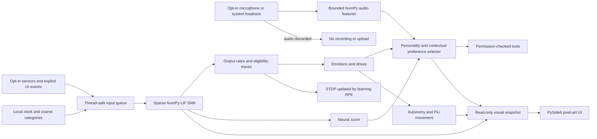

# Synapse Pet

[Português (Brasil)](README.pt-BR.md) · English


Synapse Pet is a local-first Windows desktop companion and an experiment in small spiking neural networks. The companion is **Piu**, a pixel-art canary whose expressions and movement visualize the simulation. Its decision policy combines a hand-built NumPy SNN with a small contextual-preference selector.

**It is not a language model, chatbot, or programming assistant.** It does not understand open-ended text or answer general questions. It responds to numeric/coarse-category inputs, explicit affection and feedback, and permitted local tools.


*Offline Qt render preview of the scene and Piu; not a capture of the application running on a physical desktop.*


*Generated art preview for dawn, morning, afternoon, dusk, and night.*


*Generated pixel-art animation preview. The floating window is transparent in the application.*

## Project scope

| Area | Delivered behavior |
| --- | --- |
| Desktop UI | PySide6 panel, optional transparent floating pet, system tray, full-screen view, ASCII/HUD view toggle, and panel shortcuts. |
| Character | Approved Piu pixel-art sprite sheets, emotion poses, run/jump/turn/depth views, scene backgrounds, and nearest-neighbor rendering. |
| SNN | NumPy sparse LIF population, reward-modulated STDP, eligibility traces, homeostasis, and context-specific output projections on shared sparse topology. |
| Hybrid policy | Neural firing-rate scores combined with learned per-context action preferences. Both components are reported separately in synthetic evaluations. |
| Autonomy | Bounded movement, depth-aware views, stamina-limited jumps and dancing, geometry-only window interaction, and local post-it templates. It does not run tools directly. |
| Optional audio | Individually enabled microphone and system-loopback heuristics for a listening pose and simple beat-following dances. Audio is never recorded, transcribed, or sent. |
| Local environment | Smooth local-time sky and scene, optional manual sunrise/sunset coordinates, and decorative weather that works offline. |
| Safety and privacy | Typed tool-parameter validation, permission checks, proposal/confirmation flow, local persistence, rotating diagnostics, and opt-in sensors disabled by default. |
| Learning records | Local episode and action databases, aggregate habits, optional bounded sleep replay, and an on-demand learning view. |

The implementation is still experimental. Automated tests and offscreen renders do not validate interactive behavior on every Windows desktop, GPU, multi-monitor arrangement, or DPI setting.

## Install and run on Windows

Use PowerShell from the repository folder:

```powershell
.\scripts\install.ps1
.\scripts\run.ps1
```

Or run the app directly after installing dependencies:

```powershell
python -m venv .venv
.\.venv\Scripts\python.exe -m pip install -e ".[dev,windows]"
.\.venv\Scripts\python.exe -m synapse_pet.main
```

Run the headless simulation or tests:

```powershell
.\.venv\Scripts\python.exe -m synapse_pet.main --headless --ticks 100
.\.venv\Scripts\python.exe -m pytest
```

The Windows and Linux GitHub Actions jobs use Qt's offscreen platform for automated tests. Windows is the supported desktop target; Linux CI is a test portability check.

## Modes and controls

`pet.mode: floating` shows the transparent, borderless, topmost Piu window. A mask derived from the currently displayed sprite lets clicks pass through outside the character. Double-click the Piu to open the panel; right-click opens its pet menu. The panel's **OLHO** or close control returns to the floating Piu at its saved position. The tray menu can open the panel, pause the simulation, silence autonomy, configure startup, or exit.

| Control | Effect |
| --- | --- |
| **CARINHO** | Sends deliberate positive affect and learning feedback. Hover alone gives no reward. A held drag over Piu counts after `interaction.affection_drag_min_s`. |
| **FEEDBACK** | Sends negative feedback to the simulation. |
| **DEBUG** | Shows SNN telemetry, tick, runtime regime, queues, and simulation-thread state. |
| **SENSORS** | Opens the opt-in sensor controls; sensors are off by default. |
| **APRENDIZADO** | Shows aggregate habit and reward summaries while the panel is visible. |
| **CENÁRIO / HUD** | Toggles the pixel-art scene and telemetry HUD. |
| **DESFAZER** | Reverses the latest action only when that tool supports undo. |
| **SALVAR** | Queues an asynchronous local snapshot save. |
| **ACEITAR / RECUSAR / DEPOIS** | Responds to a pending tool proposal. Risky tools require confirmation according to policy. |

Panel shortcuts: `M` toggles scene/HUD, `H` selects HUD, `F11` toggles full screen, `T` changes panel opacity, and `Esc` exits full screen. Global `Ctrl+Alt+O` opens the panel when optional `pynput` is installed. Keyboard shortcuts are not captured while the floating pet is active.

## Configuration

Edit [`configs/default.yaml`](configs/default.yaml) and restart the app.

| Setting | Purpose |
| --- | --- |
| `pet.render_style` | `pixel` (default), `spectral`, `ascii`, or `vector`. Existing eye renderers remain selectable. |
| `pet.mode`, `pet.width`, `pet.height`, `pet.anchor`, `pet.margin` | Select panel/floating mode and initial window placement. |
| `visual.scene_time` | `auto`, `dia`, `entardecer`, or `noite`; `auto` follows local time. |
| `day_cycle.sunrise_hour`, `day_cycle.sunset_hour` | Local default sunrise and sunset; optional manual `latitude`/`longitude` refine the estimates without network access. |
| `weather.mode` | `none` (default), `rain`, `fog`, or `wind`; decorative local effects only. |
| `pet.depth_in_pet_mode` | Enables depth scaling in the floating mode; default `false`. |
| `pet_motion.*`, `teleport.*` | Tunes bounded movement and motion budgets. |
| `audio.*` | Tunes in-memory voice/music thresholds, BPM behavior, cooldowns, and stamina limits. |
| `renderer` | Rendering backend: `ascii`/`cpu` or `auto` (tries OpenGL then CPU fallback). This is separate from `pet.render_style`. |
| `network.tool_output_inhibition` | Experimental output competition. Keep disabled: the configured 10-step interval did not improve scenario c/Z beyond 77.5% SNN-only, below the >80% target. |
| `sleep.replay_enabled`, `sleep.max_replay_episodes`, `sleep.replay_recent_fraction` | Opt-in, bounded sleep replay. It changes weights only when replay is explicitly enabled. |
| `network.allow_neuron_growth_migration` | Explicit opt-in snapshot migration for network growth; defaults to `false`, and shrinking is never automatic. |
| `autonomy.*`, `teleport.*` | Enable and bound local post-it and movement behaviors. |
| `privacy.sensors.*` | Opt-in sensor settings; all start disabled. |

Changing renderer style or YAML requires an application restart. The Piu sprites use integer nearest-neighbor scaling. See [ART.md](docs/ART.md) to rebuild and edit the PNG sheets and JSON animation metadata.

## Audio and local-time behavior

Voice detection uses short in-memory audio windows and simple energy, frequency
band, and modulation thresholds. It can trigger Piu's **listening** pose; it
does not identify words, intent, or who is speaking. Music detection estimates
activity and BPM from spectral changes to choose a short dance animation. If
system loopback capture is unavailable, Windows playback state can provide a
coarser dance cue without BPM synchronization. Missing optional packages or
devices leave the sensor unavailable without affecting the simulation.

The audio dependencies are optional: install them with `pip install -e ".[audio]"`
only when you plan to enable the sensors. The microphone and loopback controls
appear in **SENSORS** and the tray sensor menu; both are off by default. Read
[Privacy](docs/PRIVACY.md) before enabling them.
The optional adapters use [SoundCard](https://soundcard.readthedocs.io/en/latest/)
and, on Windows, [Pycaw](https://andremiras.github.io/pycaw/api/index.html).

The sky and landscape interpolate across local dawn, morning, afternoon, dusk,
and night. Sunrise/sunset default to 06:00/18:00; optional manual coordinates
are used only for an offline solar-time estimate. Weather is decorative and
never fetched from a service. The existing clock input feeds the simulation;
the visual scene does not change the SNN topology.

For implementation details, privacy boundaries, limitations, and synthetic
learning results, see [Architecture](docs/ARCHITECTURE.md), [Autonomy](docs/AUTONOMY.md),
[Privacy](docs/PRIVACY.md), [Learning](docs/LEARNING.md), [Art](docs/ART.md),
[Performance](docs/PERFORMANCE.md), and [Roadmap](ROADMAP.md). Contributions and
release checks are described in [CONTRIBUTING.md](CONTRIBUTING.md).

## How the SNN and learning work

1. The encoder turns permitted numeric signals and coarse context categories into sensor spikes; it never feeds typed text to the SNN.
2. Leaky integrate-and-fire neurons exchange signals through sparse sensor, recurrent, and output projections.
3. The decoder turns named output-group spikes into rates. Contexts can receive lazy output-weight projections over the shared sparse topology.
4. Eligibility traces record spike timing. `learning_rpe` is the signal that changes synaptic weights through reward-modulated STDP. `affect_impulse` changes simulated affect and remains separate from weight learning.
5. The action selector combines normalized SNN rates with contextual preferences. These preferences can dominate a combined choice; this is why the neural-only ablation is reported separately.



## Synthetic learning evaluation

These measurements use seed `20261102`, 600 requested neurons, artificial contexts/actions, and no real tools. They are generated by the offline simulator; they do **not** establish usefulness in the running desktop application. Combined accuracy uses the neural score and contextual preferences. The neural-only and preference-only columns are evaluation-time ablations after the same training history.

| Scenario | Combined | SNN-only | Preference-only | Mean absolute winner-score share: SNN / selector |
| --- | ---: | ---: | ---: | ---: |
| a — association | 100% | 100% | 100% | 41% / 59% |
| b — reversal | 100%; readaptation 44 episodes | 100% | 100% | 17% / 83% |
| c — contexts X/Y/Z | 100% / 100% / 100% | 100% / 97.5% / 77.5% | 100% / 100% / 100% | 28% / 72% (mean) |
| d — 10% feedback noise | 100% | 100% | 100% | 26% / 74% |
| e — 1,000-episode interference | 100% | 67% | 100% | 22% / 78% |

The score-share column describes the mean magnitude of the two terms for the selected candidate; it is not causal attribution. Optional replay was also tested in e and is reported in [`docs/LEARNING.md`](docs/LEARNING.md), including its remaining gap. At the configured 10-step interval, output competition matched the baseline in b and c and did not reach the >80% SNN-only target in c/Z; its measured tick overhead was about 1.1%, so the YAML flag remains off pending a useful accuracy gain. Per-episode CSVs and curves are in [`docs/learning/piu-snn-baseline/`](docs/learning/piu-snn-baseline/) and [`docs/learning/piu-snn-enabled/`](docs/learning/piu-snn-enabled/).

## Performance and limitations

Current measurements, comparison baselines, exact sample sizes, and renderer CPU/FPS are in [PERFORMANCE.md](docs/PERFORMANCE.md). They are short measurements on the development environment; CPU percentages, VRAM, DPI and desktop compositor costs vary by machine. The small pixel renderer reached 30 FPS active and 5 FPS idle in the offscreen benchmark. GUI behavior, OpenGL on physical hardware, multiple monitors, and taskbar/DPI interactions are **not validated** here.

Known limits include: the SNN is not a language model; the policy is hybrid; sleep replay uses a hashed coarse-context surrogate rather than stored sensory sequences; the replay experiment did not reach its >80% neural-only retention target; and optional output competition degraded a tested context. These gaps and deferred behavior are tracked in [`ROADMAP.md`](ROADMAP.md).

## Create a local tool

Tools declare risk, tags, parameter types, and a callable. The engine validates required fields before execution:

```python
from synapse_pet.tools.manifest import ToolManifest, ToolParameter

def count_items(params):
    return {"count": len(params["items"])}

tool = ToolManifest(
    name="count_items", description="Count supplied items", risk="low",
    tags=("example",), run=count_items,
    parameters={"items": ToolParameter(list, required=True, max_length=100)},
)
engine.register_tool(tool)
```

See [Architecture](docs/ARCHITECTURE.md), [Learning](docs/LEARNING.md), [Autonomy](docs/AUTONOMY.md), [Privacy](docs/PRIVACY.md), and [Performance](docs/PERFORMANCE.md) for detailed boundaries and methodology.
