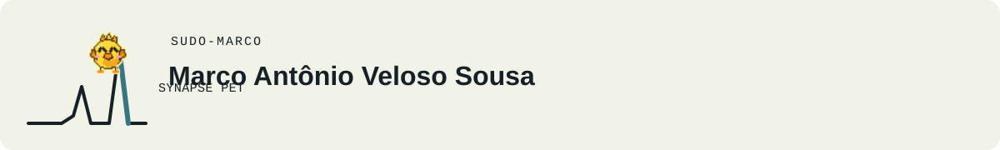
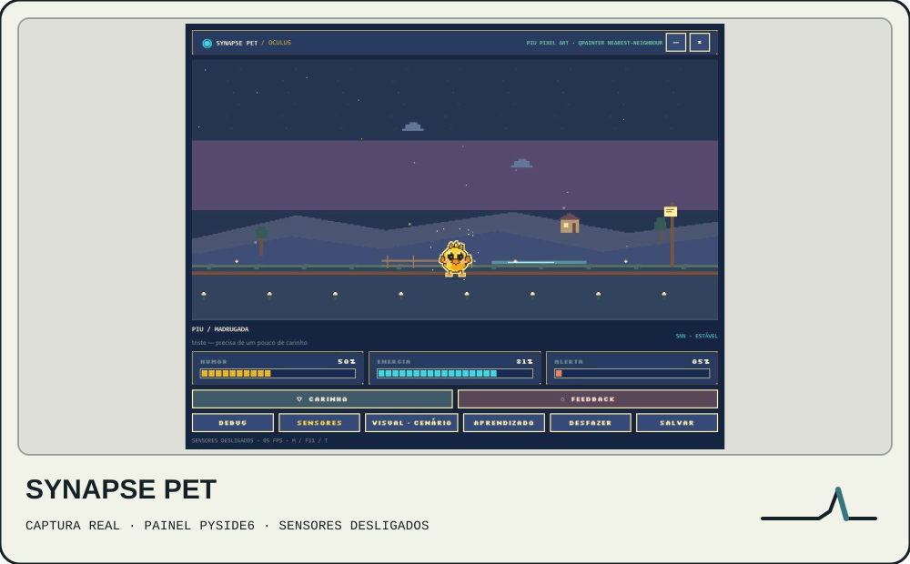
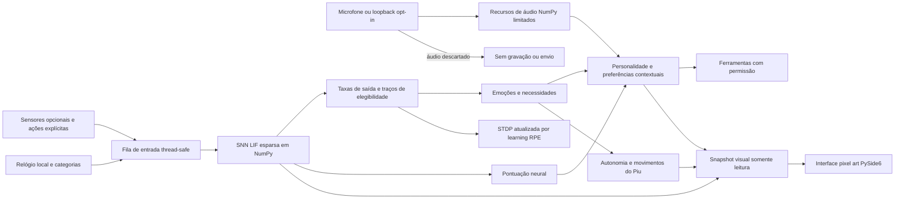
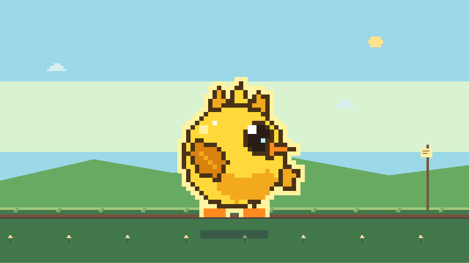
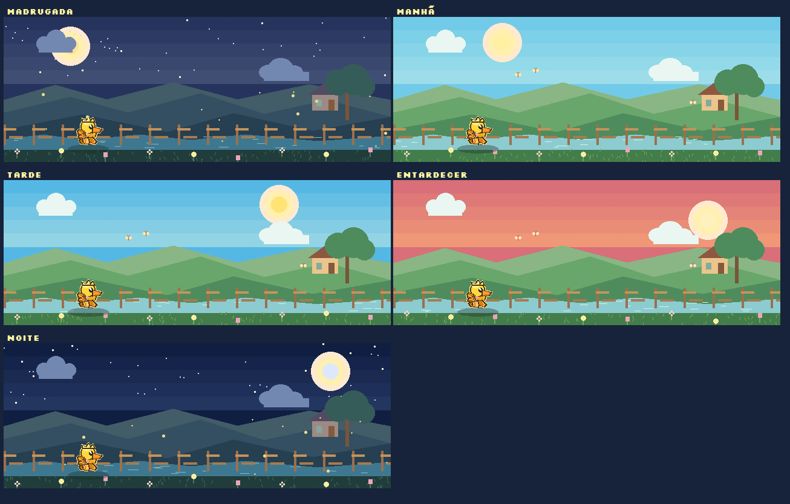
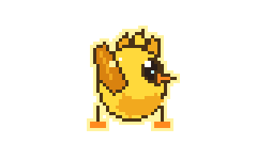

# Synapse Pet

<p align="center"><picture>
  <source media="(prefers-color-scheme: dark)" srcset="assets/brand/readme-header-dark.svg" />
  <source media="(prefers-color-scheme: light)" srcset="assets/brand/readme-header-light.svg" />
  
</picture></p>

Português (Brasil) · [English](README.en.md)

<p align="center"><picture>
  <source media="(prefers-color-scheme: dark)" srcset="assets/brand/stack-badges-dark.svg" />
  <source media="(prefers-color-scheme: light)" srcset="assets/brand/stack-badges-light.svg" />
  
</picture></p>

**Companion desktop local em Python e PySide6, com uma SNN experimental em NumPy (LIF e STDP modulada por recompensa).**

<p align="center"><picture>
  <source media="(prefers-color-scheme: dark)" srcset="assets/brand/demo-card-dark.svg" />
  <source media="(prefers-color-scheme: light)" srcset="assets/brand/demo-card-light.svg" />
  
</picture></p>

*Captura do painel em modo `window`; a configuração padrão inicia o Piu em modo flutuante. Os sensores opcionais estão desligados.*

Synapse Pet é um companheiro de desktop local para Windows e um experimento com redes neurais de disparos pequenas. O companheiro é o **Piu**, um canarinho em pixel art cujas expressões e movimentos mostram o estado da simulação. A política de decisão combina uma SNN feita à mão em NumPy com um seletor pequeno de preferências por contexto.

**Ele não é um modelo de linguagem, chatbot ou assistente de programação.** Não entende texto aberto nem responde perguntas gerais. Reage a sinais numéricos e categorias simples, carinho e feedback explícitos e ferramentas locais permitidas.

## Como rodar em 3 passos

1. Use Windows 10/11 com Python 3.10 ou superior.
2. No PowerShell, na pasta do repositório, instale as dependências:

   ```powershell
   .\scripts\install.ps1
   ```

3. Inicie o companion:

   ```powershell
   .\scripts\run.ps1
   ```

O script instala o ambiente local e inicia o modo definido em `configs/default.yaml`. Sensores opcionais começam desligados.

## Decisões técnicas

- A rede LIF esparsa e a STDP modulada por recompensa estão implementadas em NumPy; avaliações sintéticas separam a contribuição neural da preferência contextual.
- O seletor híbrido combina taxas de disparo normalizadas com preferências aprendidas por contexto. A documentação evita atribuir os resultados combinados somente à SNN.
- A interface PySide6 observa snapshots do estado da simulação; memória, episódios e configuração permanecem locais. Sensores de áudio são opcionais e não gravam nem enviam áudio.

## Escopo do projeto

| Área | O que foi implementado |
| --- | --- |
| Interface | Painel PySide6, modo flutuante transparente opcional, bandeja do sistema, tela cheia, alternância cenário/HUD e atalhos. |
| Personagem | Folhas de sprites aprovadas do Piu, poses emocionais, corrida, pulo, virada e profundidade, cenário e ampliação por vizinho mais próximo. |
| SNN | População LIF esparsa em NumPy, STDP modulada por recompensa, traços de elegibilidade, homeostase e projeções de saída por contexto sobre topologia esparsa compartilhada. |
| Política híbrida | Taxas de disparo da SNN combinadas com preferências aprendidas por contexto. Avaliações sintéticas mostram os componentes separadamente. |
| Autonomia | Movimento limitado, vistas por profundidade, pulos e dança limitados pelo fôlego, interação geométrica com janelas e post-its locais. A autonomia não executa ferramentas diretamente. |
| Áudio opcional | Heurísticas individuais para microfone e loopback do sistema, com pose de escuta e dança simples por batida. O áudio nunca é gravado, transcrito ou enviado. |
| Ambiente local | Céu e cenário suaves conforme o horário local, nascer/pôr do sol configuráveis manualmente e clima decorativo offline. |
| Segurança e privacidade | Validação de parâmetros tipados, permissões, propostas e confirmações, dados locais, logs rotativos e sensores opcionais desligados por padrão. |
| Aprendizado observável | Banco local de episódios e ações, hábitos agregados, replay opcional durante sono e aba de aprendizado sob demanda. |

O projeto ainda é experimental. Testes automatizados e renderizações offscreen não validam a interação em todos os desktops Windows, GPUs, configurações de monitor ou escalas de DPI.

## Instalação e execução no Windows

No PowerShell, dentro da pasta do repositório:

```powershell
.\scripts\install.ps1
.\scripts\run.ps1
```

Ou execute diretamente após instalar as dependências:

```powershell
python -m venv .venv
.\.venv\Scripts\python.exe -m pip install -e ".[dev,windows]"
.\.venv\Scripts\python.exe -m synapse_pet.main
```

Simulação sem interface e testes:

```powershell
.\.venv\Scripts\python.exe -m synapse_pet.main --headless --ticks 100
.\.venv\Scripts\python.exe -m pytest
```

As ações do GitHub executam os testes no Windows e Linux com o Qt offscreen. Windows é o alvo de desktop; o CI no Linux é apenas uma verificação de portabilidade dos testes.

## Modos e controles

`pet.mode: floating` mostra somente o Piu numa janela transparente, sem borda e sempre no topo. Uma máscara extraída do sprite exibido deixa os cliques passarem fora do personagem. Clique duas vezes no Piu para abrir o painel; clique direito abre o menu do mascote. O botão **OLHO** ou o botão de fechar do painel retorna o Piu à posição salva. A bandeja pode abrir o painel, pausar a simulação, silenciar a autonomia, configurar inicialização ou sair.

| Controle | Ação |
| --- | --- |
| **CARINHO** | Envia afeto positivo deliberado e feedback de aprendizado. Só passar o mouse não gera recompensa. Arrastar sobre o Piu conta após `interaction.affection_drag_min_s`. |
| **FEEDBACK** | Envia feedback negativo à simulação. |
| **DEBUG** | Exibe telemetria da SNN, tick, regime, filas e estado da thread. |
| **SENSORES** | Abre os controles de sensores opcionais, desligados por padrão. |
| **APRENDIZADO** | Mostra estatísticas agregadas de hábitos e recompensas enquanto o painel está visível. |
| **CENÁRIO / HUD** | Alterna entre cenário pixel art e HUD de telemetria. |
| **DESFAZER** | Desfaz a última ação somente se a ferramenta oferecer essa função. |
| **SALVAR** | Enfileira um snapshot local assíncrono. |
| **ACEITAR / RECUSAR / DEPOIS** | Responde a uma proposta pendente. Ferramentas de maior risco seguem as confirmações exigidas. |

Atalhos do painel: `M` alterna cenário/HUD, `H` seleciona HUD, `F11` alterna tela cheia, `T` muda a opacidade e `Esc` sai da tela cheia. `Ctrl+Alt+O` abre o painel se o pacote opcional `pynput` estiver instalado. O programa não captura atalhos enquanto o Piu flutuante está ativo.

## Configuração

Edite [`configs/default.yaml`](configs/default.yaml) e reinicie o aplicativo.

| Opção | Função |
| --- | --- |
| `pet.render_style` | `pixel` (padrão), `spectral`, `ascii` ou `vector`. Os renderizadores antigos do olho continuam disponíveis. |
| `pet.mode`, `pet.width`, `pet.height`, `pet.anchor`, `pet.margin` | Escolhe painel ou janela flutuante e sua posição inicial. |
| `visual.scene_time` | `auto`, `dia`, `entardecer` ou `noite`; `auto` usa o horário local. |
| `day_cycle.sunrise_hour`, `day_cycle.sunset_hour` | Nascer e pôr do sol padrão; `latitude`/`longitude` manuais refinam a estimativa sem rede. |
| `weather.mode` | `none` (padrão), `rain`, `fog` ou `wind`; apenas efeitos decorativos locais. |
| `pet.depth_in_pet_mode` | Habilita escala por profundidade no modo flutuante; padrão `false`. |
| `pet_motion.*`, `teleport.*` | Ajusta movimentos limitados e seus orçamentos. |
| `audio.*` | Ajusta limites heurísticos de voz/música, BPM, cooldowns e limites de fôlego. |
| `renderer` | Backend de desenho: `ascii`/`cpu` ou `auto` (tenta OpenGL e usa fallback CPU). É separado de `pet.render_style`. |
| `network.tool_output_inhibition` | Competição experimental entre saídas. Mantenha desligada: no intervalo configurado de 10 passos, c/Z ficou em 77,5% SNN-only, abaixo da meta de >80%. |
| `sleep.replay_enabled`, `sleep.max_replay_episodes`, `sleep.replay_recent_fraction` | Replay limitado e opcional durante o sono; altera pesos somente se habilitado. |
| `network.allow_neuron_growth_migration` | Autoriza migração explícita ao aumentar a rede; padrão `false`; redução nunca é automática. |
| `autonomy.*`, `teleport.*` | Habilita e limita post-its e movimentos locais. |
| `privacy.sensors.*` | Configura sensores opcionais, todos inicialmente desligados. |

Alterações no YAML ou estilo de renderização exigem reiniciar o aplicativo. Os sprites do Piu usam ampliação inteira por vizinho mais próximo. Consulte [ART.md](docs/ART.md) para editar as folhas PNG e os metadados JSON.

## Áudio e comportamento pelo horário local

A detecção de voz usa pequenas janelas em memória e limites simples de energia,
faixa de frequência e modulação. Ela pode mostrar a pose **ouvindo**; não
reconhece palavras, intenção nem quem está falando. A detecção de música estima
atividade e BPM por mudanças espectrais para escolher uma dança curta. Se a
captura de loopback não estiver disponível, o estado de reprodução do Windows
pode fornecer uma indicação mais simples, sem sincronização por BPM. Pacotes ou
dispositivos ausentes deixam o sensor indisponível sem afetar a simulação.

As dependências de áudio são opcionais: instale com `pip install -e ".[audio]"`
somente se for habilitar esses sensores. Os controles aparecem em **SENSORES** e
no menu de sensores da bandeja; ambos começam desligados. Leia
[Privacidade](docs/PRIVACY.md) antes de ativá-los.
Os adaptadores opcionais usam [SoundCard](https://soundcard.readthedocs.io/en/latest/)
e, no Windows, [Pycaw](https://andremiras.github.io/pycaw/api/index.html).

O céu e a paisagem interpolam entre madrugada, manhã, tarde, entardecer e noite.
Nascer e pôr do sol usam 06:00/18:00 por padrão; coordenadas manuais opcionais
refinam uma estimativa solar offline. O clima é decorativo e não vem de serviços
externos. A entrada de relógio existente continua alimentando a simulação; a
cena visual não altera a topologia da SNN.

Detalhes de implementação, privacidade, limitações e resultados sintéticos estão
em [Arquitetura](docs/ARCHITECTURE.md), [Autonomia](docs/AUTONOMY.md),
[Privacidade](docs/PRIVACY.md), [Aprendizado](docs/LEARNING.md), [Arte](docs/ART.md),
[Desempenho](docs/PERFORMANCE.md) e [Roadmap](ROADMAP.md). As regras de
contribuição e release estão em [CONTRIBUTING.md](CONTRIBUTING.md).

## Como funcionam a SNN e o aprendizado

1. O codificador transforma sinais numéricos permitidos e categorias simples em disparos sensoriais; texto digitado nunca entra na SNN.
2. Neurônios leaky integrate-and-fire se comunicam por projeções esparsas sensoriais, recorrentes e de saída.
3. O decodificador converte grupos de disparos em taxas. Cada contexto pode receber pesos de saída alocados sob demanda sobre a topologia esparsa compartilhada.
4. Traços de elegibilidade registram a temporização dos disparos. `learning_rpe` é o sinal que altera pesos via STDP modulada por recompensa. `affect_impulse` altera o afeto simulado e permanece separado do aprendizado dos pesos.
5. O seletor combina taxas da SNN normalizadas e preferências por contexto. As preferências podem dominar uma decisão combinada; por isso a ablação SNN-only é mostrada separadamente.



## Avaliação sintética de aprendizado

As medições usam seed `20261102`, 600 neurônios solicitados, contextos e ações artificiais e nenhuma ferramenta real. Os resultados vêm do simulador offline e **não demonstram utilidade no aplicativo desktop em execução**. A precisão combinada usa taxas neurais e preferências contextuais. As colunas SNN-only e preferência-only são ablações de avaliação após a mesma história de treinamento.

| Cenário | Combinada | SNN-only | Só preferências | Média da magnitude do score vencedor: SNN / seletor |
| --- | ---: | ---: | ---: | ---: |
| a — associação | 100% | 100% | 100% | 41% / 59% |
| b — reversão | 100%; readaptação em 44 episódios | 100% | 100% | 17% / 83% |
| c — contextos X/Y/Z | 100% / 100% / 100% | 100% / 97,5% / 77,5% | 100% / 100% / 100% | 28% / 72% (média) |
| d — 10% de ruído no feedback | 100% | 100% | 100% | 26% / 74% |
| e — interferência de 1.000 episódios | 100% | 67% | 100% | 22% / 78% |

A fração da tabela descreve a magnitude média dos dois termos para o candidato escolhido; não é uma atribuição causal. O replay opcional também foi testado no cenário e; [LEARNING.md](docs/LEARNING.md) registra o resultado e a meta ainda não atingida. No intervalo de 10 passos, a competição de saída igualou a linha de base em b e c e não alcançou a meta SNN-only >80% em c/Z; o custo medido por tick ficou cerca de 1,1% maior. A flag YAML permanece desligada até haver ganho útil de acerto. CSVs e curvas por episódio estão em [`docs/learning/piu-snn-baseline/`](docs/learning/piu-snn-baseline/) e [`docs/learning/piu-snn-enabled/`](docs/learning/piu-snn-enabled/).

## Desempenho e limitações

As medições atuais, linhas de comparação, número de amostras e CPU/FPS do renderizador estão em [PERFORMANCE.md](docs/PERFORMANCE.md). São amostras curtas no ambiente de desenvolvimento; CPU, VRAM, DPI e composição do desktop variam conforme a máquina. O renderizador pixel art alcançou 30 FPS ativo e 5 FPS em repouso no benchmark offscreen. Interface interativa, OpenGL em hardware físico, múltiplos monitores e comportamento com barra de tarefas/DPI **não foram validados** aqui.

Limitações conhecidas: a SNN não é um modelo de linguagem; a política é híbrida; replay usa uma entrada substituta derivada do hash de uma categoria, não sequências sensoriais armazenadas; a experiência de replay não atingiu a meta de >80% de retenção SNN-only; e a competição opcional piorou um contexto medido. Essas pendências estão em [`ROADMAP.md`](ROADMAP.md).

## Roadmap atual

O roadmap acompanha a melhoria da classificação neural por contexto e da retenção, avaliação com várias seeds e intervalos de confiança, revisão das regras experimentais de inibição/replay e validação interativa em Windows com diferentes monitores, escalas de DPI e renderizadores. São itens em aberto, não capacidades já entregues.

## Criar uma ferramenta local

Uma ferramenta declara risco, tags, tipos de parâmetros e uma função. O engine valida os campos obrigatórios antes da execução:

```python
from synapse_pet.tools.manifest import ToolManifest, ToolParameter

def count_items(params):
    return {"count": len(params["items"])}

tool = ToolManifest(
    name="count_items", description="Contar itens fornecidos", risk="low",
    tags=("example",), run=count_items,
    parameters={"items": ToolParameter(list, required=True, max_length=100)},
)
engine.register_tool(tool)
```

Consulte [Arquitetura](docs/ARCHITECTURE.md), [Aprendizado](docs/LEARNING.md), [Autonomia](docs/AUTONOMY.md), [Privacidade](docs/PRIVACY.md) e [Desempenho](docs/PERFORMANCE.md) para limites e metodologia detalhados.

## Galeria

### Cenário diurno



*Prévia offline renderizada pelo Qt; não é uma captura do programa em um desktop físico.*

### Conceitos dos ambientes



*Prévia de arte gerada para madrugada, manhã, tarde, entardecer e noite.*

### Animação flutuante do Piu



*Prévia gerada da animação em pixel art. Na aplicação, a janela flutuante é transparente.*
