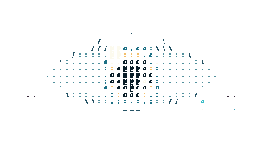
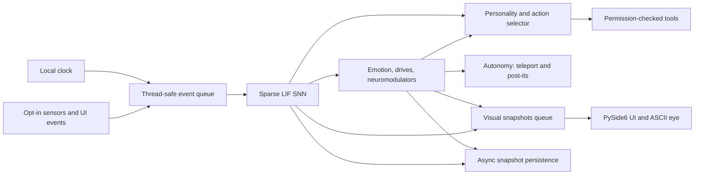

# Synapse Pet

[English](README.md) · [Português (Brasil)](README.pt-BR.md)


**Synapse Pet** is an experimental desktop companion driven by a small, local spiking neural network (SNN). Its state controls an animated ASCII eye, bounded autonomous behaviors, and a compact telemetry panel. It is a simulation and learning experiment, not a conversational AI assistant.

The default experience is a transparent, floating eye. The configuration panel opens on demand. The project is designed to grow in measured, testable increments while keeping the simulation, data, and tools on the user's computer.



*Renderer capture from a headless Qt session. It demonstrates the transparent pet buffer; it is not a screenshot of the application running on a user's desktop.*

## Project status

| Area | Current implementation |
| --- | --- |
| Desktop UI | PySide6; transparent floating mode and an on-demand panel, tray controls, click-through mask, position persistence, and global panel shortcut when `pynput` is installed. |
| Avatar | Animated ASCII eye with emotional expressions, gaze, day/night lighting, blinking, sleep, and a CPU-compatible renderer. |
| Teleport | Short, emotion-dependent animation with a particle trail, destination bounds, cooldown, hourly limit, and proposal/drag guards. |
| SNN | Sparse LIF network; 600 requested neurons by default (tool output groups increase the runtime population). |
| Learning | Reward-modulated STDP, eligibility traces, homeostasis, affect impulses, and contextual action preferences. Sleep replay is optional and disabled by default. |
| Autonomy | Budgeted, local post-it windows; aggregate habit tracking; existing gaze, idle glance, sleep, and affection reactions. |
| Tools | Typed manifest validation before dispatch, permission checks, user confirmation for higher-risk actions, and asynchronous execution. |
| Evaluation | Reproducible synthetic scenarios with CSV/JSON results and plots under `docs/learning/`. |
| Language-model assistance | Not implemented. The pet does not understand open-ended questions or generate programming answers. |

The UI changes in this project have been checked with automated tests and short offscreen Qt runs. Those checks do **not** establish full interactive behavior on every Windows desktop, GPU, multi-monitor setup, or display-scaling configuration.

## What it can and cannot do

**Implemented:** simulate neural and affective state; animate the eye; respond to deliberate affection and feedback; learn bounded associations in synthetic scenarios; show local template notes; and propose configured local tools under their permission rules.

**Not implemented:** a chatbot, code assistant, web search agent, general language understanding, or general-purpose autonomous computer control. The SNN receives numeric features and coarse categories; it does not read typed text. Combined scenario results use both neural scores and contextual preferences, so they should not be described as SNN-only performance.

## Requirements and installation

- Windows 10 or 11 is the primary desktop target.
- Python 3.10 or newer.
- Internet access is needed to install packages. The running simulation itself is local; `abrir_url` can access the internet only after an explicit user action.

In PowerShell, from the repository root:

```powershell
.\scripts\install.ps1
.\scripts\run.ps1
```

The installer creates `.venv` and installs the project, development tools, and optional Windows sensors. To start the app directly:

```powershell
.\.venv\Scripts\python.exe -m synapse_pet.main
```

To run a short headless simulation:

```powershell
.\.venv\Scripts\python.exe -m synapse_pet.main --headless --ticks 100
```

For a manual environment setup:

```powershell
python -m venv .venv
.\.venv\Scripts\python.exe -m pip install -e ".[dev,windows]"
```

The configured GitHub Actions workflow runs the test suite on Windows and Linux with Qt's offscreen platform. This is a portability check, not a promise of a supported Linux desktop experience.

## Floating pet and controls

`pet.mode: floating` is the default. It shows only the eye in a transparent, borderless, topmost tool window. The eye's mask lets clicks pass through outside its visible body; dragging moves it. Double-click opens the panel, while right-click opens the small pet menu. The system tray can open the panel, pause/resume the simulation, silence autonomy, configure Windows startup, or exit. The default global shortcut is `Ctrl+Alt+O` and requires the optional `pynput` package.

Set `pet.mode: window` in `configs/default.yaml` to open the full panel directly. Close the panel to return to floating mode.

| Panel control | Effect |
| --- | --- |
| **CARINHO** | Sends deliberate positive affect and learning feedback. A drag held over the eye for `interaction.affection_drag_min_s` (1 second by default) also counts. Hover alone does not reward the pet. |
| **FEEDBACK** | Sends negative user feedback to the simulation. |
| **DEBUG** | Opens neural telemetry including tick, regime, queue, and simulation-thread status. |
| **SENSORES** | Opens the opt-in sensor menu. Sensors are disabled by default. |
| **EXPRESSÕES · ASCII** | Switches the panel between the ASCII view and the HUD. |
| **APRENDIZADO** | Opens aggregate habit counts and reward statistics. Its refresh timer runs only while the panel is visible. |
| **DESFAZER** | Requests undo for the most recent tool that implements undo. It does not undo changes to the simulation. |
| **SALVAR** | Queues a snapshot save; disk writing runs outside the simulation's critical tick path. |
| **ACEITAR / RECUSAR / DEPOIS** | Answers a pending tool proposal. Higher-risk tools require explicit confirmation. |

In the panel, `M` toggles ASCII/HUD, `H` selects HUD, `F11` toggles full-screen, `T` changes panel opacity, and `Esc` leaves full-screen. These shortcuts are disabled in floating mode to avoid capturing unrelated keys.

## Configuration

Edit [`configs/default.yaml`](configs/default.yaml) and restart the application. Common options:

| Setting | Purpose |
| --- | --- |
| `pet.mode`, `pet.width`, `pet.height`, `pet.anchor`, `pet.margin` | Select panel or floating mode and set the eye's size and initial placement. |
| `pet.panel_hotkey` | Global shortcut to show the panel (optional `pynput`). |
| `renderer` | `ascii` is the default. `cpu` forces the QPainter fallback. `auto` tries the OpenGL-compatible renderer and falls back to QPainter if initialization fails. |
| `visual.ascii_columns`, `visual.ascii_rows` | Set the starting ASCII grid density. The `ascii_max_*` values cap resolution as the panel grows. |
| `visual.scene_time` | `auto`, `dia`, `entardecer`, or `noite`. |
| `teleport.enabled`, `teleport.cooldown_s`, `teleport.max_per_hour`, `teleport.targets` | Control autonomous teleport triggers, rate limits, and allowed destinations. |
| `autonomy.enabled`, `autonomy.max_actions_per_hour`, `autonomy.postits.*` | Silence autonomy or set post-it budgets, expiry, thresholds, and templates. Templates are local configuration text. |
| `sleep.replay_enabled` | Enables bounded replay of high-reward episodes during sleep. Default: `false`. |
| `network.allow_neuron_growth_migration` | Authorizes explicit snapshot migration when configured neuron count exceeds saved snapshot (e.g. 600→800). Creates a verified backup before migrating, preserves all existing weights, neuronal states, context projections, and dynamic tool groups. Never shrinks a larger saved network. Default: `false`. |
| `habits.enabled`, `habits.minimum_observations`, `habits.minimum_mean_rpe` | Enable aggregate habit counts. The habit table stores only a fixed category, action key, counts, reward averages, and timestamp. |
| `privacy.sensors.*` | Configure the opt-in sensors; all default to `false`. |

### Teleport and autonomous notes

Teleport styles follow the current state: curious and happy states use a brighter arc; stress uses a short, shaky movement; low energy uses a slower movement; attention can move the eye near the cursor or active-window rectangle. Only screen coordinates and window geometry are queried for placement; window titles and contents are not read. Destinations are clamped to each monitor's available geometry so the pet avoids the taskbar.

A teleport requires sufficient SNN initiative, respects the hourly cap and cooldown, and is suppressed during drag, recent interaction, a pending proposal, or paused/stopped simulation. Post-its are independent frameless app windows, at most four by default, and expire after ten minutes. Closing one quickly gives a small negative signal; selecting **Entendi** gives a small positive signal. SQLite stores only the template ID, state category, geometry, and expiry—not the rendered note text. Full-screen suppression uses window bounds on Windows and does not inspect the window title.

## Architecture



The simulation runs in a worker thread. The GUI sends events through a thread-safe queue and receives immutable, one-slot visual snapshots. Tool execution and snapshot disk writes use worker executors. The UI does not perform SNN ticks. Runtime exceptions are logged with tracebacks; a watchdog reports stale ticks instead of presenting frozen values as live.

More detail: [Architecture](docs/ARCHITECTURE.md), [Autonomy](docs/AUTONOMY.md), [Privacy](docs/PRIVACY.md), and [Performance](docs/PERFORMANCE.md).

## How learning works

1. **LIF dynamics:** sensor features stimulate leaky integrate-and-fire neurons; sparse projections connect sensor, recurrent, and output populations.
2. **Rate decoding:** named output groups provide numeric firing-rate signals for emotional states and tool candidates.
3. **R-STDP:** spike-timing eligibility traces receive a reward-prediction-error (RPE) signal. Action-specific credit is applied to the selected output group where available.
4. **Affect is separate from learning:** deliberate affection/feedback may change the simulated emotional state immediately. Only the learning RPE updates synaptic weights. Hover does not generate positive affect or reward.
5. **Contextual preferences:** a small selector stores action preferences by coarse context and combines them with neural scores. A high combined accuracy is not an SNN-only result.
6. **Homeostasis and sleep:** homeostasis constrains population activity. The optional replay flag re-presents a small set of high-absolute-reward episodes using a simplified synthetic input derived from a hashed coarse context. It is off by default; the original full sensor vector is not retained or replayed.
7. **Habits:** repeated positive RPE is summarized as a count and mean by fixed context/action identifiers. This is an observable aggregate, not a learned language skill or a change to the network topology.

The detailed protocol, scores, ablations, and curves are in [Learning results](docs/LEARNING.md) and [`docs/learning/`](docs/learning/).

## Synthetic learning results

The recorded context-projection evaluation uses seed `20261102`, 600 requested neurons, artificial actions, and no real tools. Results are from the combined policy unless marked neural-only.

| Scenario | Combined policy | Neural-only ablation | SNN / contextual-selector share of winner score |
| --- | ---: | ---: | ---: |
| a — association | 100% | 100% | 43% / 57% |
| b — reversal | 100%; readaptation in 44 episodes | 100% (strict SNN-only training: 100%, 49 episodes) | 21% / 79% |
| c — X | 100% | 100% | 24% / 76% |
| c — Y | 100% | 97.5% | 40% / 60% |
| c — Z | 100% | 77.5% | 32% / 68% |
| d — 10% feedback noise | 100% | 100% | 31% / 69% |
| e — retention after interference | 100% | 67% | 29% / 71% |

The score shares are descriptive decompositions of the combined winner score, not causal attribution. In scenario **e**, the preference selector contributes materially to the result. These results are synthetic and do not establish useful behavior in the live desktop app. Curves and episode-level CSVs are linked from [docs/learning/README.md](docs/learning/README.md).

## Performance observations

A short CPU benchmark after the current SNN changes compared 60 active ticks against a previous 300-tick sample. The small sample and CPU timer resolution limit the precision; see [the JSON report](benchmarks/results/snn_launch_comparison.json).

| Requested network size | Before | Current sample | Change |
| ---: | ---: | ---: | ---: |
| 600 neurons | 9.1146 ms/tick | 9.1146 ms/tick | 0.00% |
| 1,000 neurons | 18.9063 ms/tick | 18.7500 ms/tick | −0.83% |

The current process RSS sample was 55.30 MiB at 600 requested neurons and 55.87 MiB at 1,000. The engine idle probe measured 0.78% of one logical core. A separate 4-second offscreen floating-UI sample measured 0.39% at a 200 ms (5 FPS) timer interval. These are short local samples, not physical Windows desktop guarantees. The 1,000-neuron tick delta is within timer noise and should not be treated as an improvement. VRAM and renderer costs vary by GPU and compositor. See [PERFORMANCE.md](docs/PERFORMANCE.md) for scope and older renderer measurements.

## Privacy and local data

- The simulation, snapshots, episode memory, habit aggregates, post-it metadata, and logs are stored locally under `%APPDATA%\synapse_pet` on Windows.
- Opt-in sensors start disabled. Input activity records counts, not key identity or typed text. Active-window sensing emits a configured category from the executable name and does not read titles. The clipboard counter sensor returns only a length/count signal and does not persist clipboard text.
- The separate, medium-risk `historico_clipboard` tool can capture up to 4,000 clipboard characters only when explicitly invoked with `capture: true` and accepted. Its contents are stored in local SQLite; do not enable or accept it unless that is intended.
- File monitoring reports counts; the explicit file-summary tool may return changed file names from an allowed folder. Tool results remain local to the application unless another explicit action is taken.
- Post-it text comes from local YAML templates. Post-it SQLite records do not contain text. Habit records use fixed categories/action IDs and contain aggregate statistics only.
- Python plugins run with the current user's operating-system permissions; the app's permission manager is not an OS sandbox.

See the data inventory in [PRIVACY.md](docs/PRIVACY.md).

## Adding a tool

A tool uses a manifest, a risk level, an explicit parameter schema, and a function that returns a result. Example (the real code also adds permissions and tests):

```python
from synapse_pet.tools.manifest import ToolManifest, ToolParameter

def run(params):
    return {"status": "ok", "count": len(params["items"])}

manifest = ToolManifest(
    name="count_items", description="Count supplied items", risk="low",
    tags=("example",), run=run,
    parameters={"items": ToolParameter(list, required=True, max_length=100)},
)
```

The engine validates required fields and types before showing a proposal or dispatching a tool. See `src/synapse_pet/tools/builtin/basic.py` for built-in examples and the permission layer.

## Tests and development

```powershell
.\.venv\Scripts\python.exe -m pytest
.\.venv\Scripts\python.exe benchmarks\snn_baseline.py --ticks 60 --profile-steps 40 --idle-seconds 2
```

The automated suite includes determinism, snapshots/migrations, reward separation, sensor privacy, tool schemas, sleep/replay gating, autonomy budgets, teleport geometry, and runtime recovery. GitHub Actions is configured to run the suite headlessly on Windows and Linux; the first hosted result is pending the release push. Benchmarks are local diagnostics, not stable hardware guarantees. Contribution guidance is in [CONTRIBUTING.md](CONTRIBUTING.md).

## Honest limitations and roadmap

The SNN operates on numerical features and coarse categories; it is not a language model. Scenario evaluation is synthetic. The combined action policy relies on both the SNN and contextual preferences. Sleep replay uses reconstructed, simplified inputs and has not been evaluated against the scenario-e performance target. Teleport and post-it behavior has been checked offscreen, not validated as a live desktop experience across Windows/GPU/multi-monitor combinations.

Remaining work is tracked in [ROADMAP.md](ROADMAP.md), including larger post-it behavior coverage, 600→800 snapshot migration, personality parameters that affect neural decisions, and targeted profiling. Optional future directions include a skills layer, a local LLM-backed narrator provider, MCP integration, and browser actions; none is implemented today.

## License

[MIT](LICENSE). See [CHANGELOG.md](CHANGELOG.md) for the current release history.
