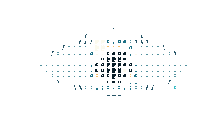
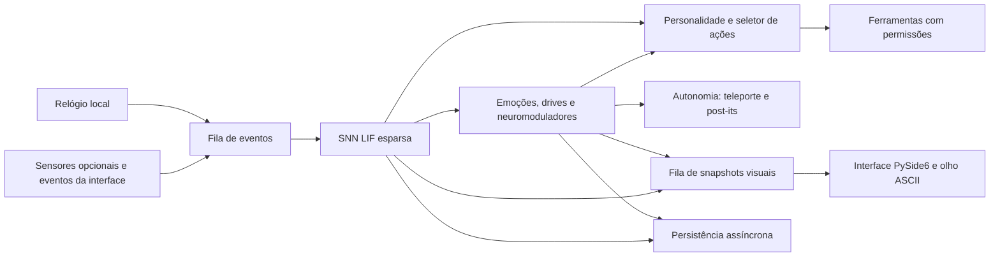

# Synapse Pet

[English](README.md) · [Português (Brasil)](README.pt-BR.md)


**Synapse Pet** é um companheiro de desktop experimental controlado por uma pequena rede neural de impulsos local (SNN). O estado simulado influencia um olho animado em ASCII, comportamentos autônomos limitados e um painel de telemetria. É uma simulação e um experimento de aprendizado, não um assistente conversacional.

Por padrão, o pet é um olho transparente e flutuante. O painel de configuração abre sob demanda. O projeto cresce em etapas verificáveis, mantendo a simulação, os dados e as ferramentas no computador do usuário.



*Captura do renderizador em uma sessão Qt headless. Ela demonstra o buffer transparente do pet; não é uma captura do aplicativo em uma área de trabalho real.*

## Estado do projeto

| Área | Implementação atual |
| --- | --- |
| Interface | PySide6; modo flutuante transparente e painel sob demanda, bandeja, máscara de cliques, posição persistida e atalho global quando `pynput` está instalado. |
| Avatar | Olho ASCII animado com expressões, direção do olhar, ciclo de iluminação, piscadas, sono e renderizador compatível com CPU. |
| Teleporte | Animação curta por emoção, com rastro, limites por monitor, cooldown, cota horária e bloqueios durante arrasto ou proposta pendente. |
| SNN | Rede LIF esparsa; 600 neurônios solicitados por padrão (grupos de saída de ferramentas aumentam a população em execução). |
| Aprendizado | R-STDP modulada por recompensa, traços de elegibilidade, homeostase, impulsos afetivos e preferências contextuais. Replay no sono é opcional e vem desligado. |
| Autonomia | Post-its locais com orçamento, registro agregado de hábitos e reações visuais existentes de olhar, repouso, sono e carinho. |
| Ferramentas | Validação de parâmetros antes da execução, permissões, confirmação de ações de maior risco e execução assíncrona. |
| Avaliação | Cenários sintéticos reproduzíveis, com resultados CSV/JSON e curvas em `docs/learning/`. |
| Assistência por modelo de linguagem | Não implementada. O pet não entende perguntas abertas nem gera respostas de programação. |

As mudanças de interface foram verificadas com testes automatizados e execuções Qt curtas em modo offscreen. Isso **não** comprova o funcionamento interativo em toda combinação de Windows, GPU, múltiplos monitores e escala de tela.

## O que faz e o que não faz

**Implementado:** simula estados neurais e afetivos; anima o olho; reage a carinho deliberado e feedback; aprende associações delimitadas em cenários sintéticos; mostra notas com templates locais; e pode propor ferramentas locais configuradas e sujeitas a permissões.

**Não implementado:** chatbot, copiloto de programação, busca na web, compreensão geral de linguagem ou controle autônomo genérico do computador. A SNN recebe números e categorias aproximadas; não lê o texto digitado. Os resultados combinados usam pontuação neural e preferências contextuais, então não devem ser apresentados como desempenho exclusivo da SNN.

## Requisitos e instalação

- Windows 10 ou 11 é o alvo principal para desktop.
- Python 3.10 ou superior.
- É necessário internet para instalar os pacotes. A simulação é local; `abrir_url` pode acessar a internet somente após uma ação explícita do usuário.

No PowerShell, na raiz do repositório:

```powershell
.\scripts\install.ps1
.\scripts\run.ps1
```

O instalador cria `.venv` e instala o projeto, as ferramentas de desenvolvimento e os sensores opcionais de Windows. Para iniciar diretamente:

```powershell
.\.venv\Scripts\python.exe -m synapse_pet.main
```

Para executar uma simulação headless curta:

```powershell
.\.venv\Scripts\python.exe -m synapse_pet.main --headless --ticks 100
```

Configuração manual do ambiente:

```powershell
python -m venv .venv
.\.venv\Scripts\python.exe -m pip install -e ".[dev,windows]"
```

O workflow configurado no GitHub Actions executa os testes em Windows e Linux com a plataforma offscreen do Qt. Isso verifica portabilidade do código, não representa suporte completo a desktop Linux.

## Pet flutuante e controles

`pet.mode: floating` é o padrão. Ele mostra somente o olho em uma janela sem borda, transparente e sempre no topo. A máscara do olho deixa cliques passarem fora da área visível; arrastar move o pet. Clique duplo abre o painel e clique direito abre o menu compacto. Ao retornar, o olho recupera sua posição anterior; o botão **◉ OLHO** e o botão de fechar do cabeçalho retornam ao avatar. A bandeja permite abrir o painel, pausar/retomar a simulação, silenciar autonomia, configurar a inicialização do Windows ou sair. O atalho global padrão é `Ctrl+Alt+O` e depende do pacote opcional `pynput`.

Altere `pet.mode: window` em `configs/default.yaml` para iniciar com o painel aberto. Fechar o painel retorna ao modo flutuante.

| Controle do painel | Função |
| --- | --- |
| **CARINHO** | Envia afeto deliberado e feedback de aprendizado positivo. Arrastar sobre o olho pelo tempo definido em `interaction.affection_drag_min_s` (1 segundo por padrão) também vale. Hover sozinho não recompensa o pet. |
| **FEEDBACK** | Envia feedback negativo à simulação. |
| **DEBUG** | Abre telemetria neural: tick, regime, filas e estado da thread de simulação. |
| **SENSORES** | Abre o menu de sensores opcionais. Todos começam desligados. |
| **EXPRESSÕES · ASCII** | Alterna o painel entre a arte ASCII e o HUD. |
| **APRENDIZADO** | Mostra contagens agregadas de hábitos e estatísticas de recompensa. O timer de atualização funciona somente enquanto a janela está aberta. |
| **DESFAZER** | Solicita desfazer a última ferramenta que implemente essa operação. Não desfaz mudanças da simulação. |
| **SALVAR** | Enfileira um snapshot; a gravação em disco ocorre fora do caminho crítico dos ticks. |
| **ACEITAR / RECUSAR / DEPOIS** | Responde a uma proposta de ferramenta. Ações de maior risco exigem confirmação explícita. |

No painel: `M` alterna ASCII/HUD, `H` escolhe HUD, `F11` alterna tela cheia, `T` ajusta a opacidade e `Esc` sai da tela cheia. Esses atalhos ficam desativados no modo flutuante para não capturar teclas de outros aplicativos.

## Configuração

Edite [`configs/default.yaml`](configs/default.yaml) e reinicie o aplicativo.

| Opção | Efeito |
| --- | --- |
| `pet.mode`, `pet.width`, `pet.height`, `pet.anchor`, `pet.margin` | Escolhe painel ou modo flutuante e configura tamanho e posição inicial. |
| `pet_motion.enabled`, `pet_motion.interval_min_s`, `pet_motion.interval_max_s`, `pet_motion.amplitude_px` | Ativa saltos autônomos espaçados e ajusta a altura conforme o estado emocional. |
| `pet.panel_hotkey` | Atalho global para abrir o painel (opcional `pynput`). |
| `pet.density`, `pet.outline.*` | Ajusta densidade `bold|normal|fine`, célula mínima (8 px por padrão), filetes de contraste, placa e preferência de tema do Windows. Veja [renderização ASCII](docs/ASCII_RENDERING.md) e as [capturas LOD](docs/screenshots/legibility/lod_final/RELATORIO_CONTRASTE.md). |
| `renderer` | `ascii` é o padrão. `cpu` força fallback QPainter. `auto` tenta OpenGL e usa QPainter se a inicialização falhar. |
| `visual.ascii_columns`, `visual.ascii_rows` | Densidade inicial da grade ASCII. `ascii_max_*` limita a resolução quando o painel cresce. |
| `visual.scene_time` | `auto`, `dia`, `entardecer` ou `noite`. |
| `teleport.enabled`, `teleport.cooldown_s`, `teleport.max_per_hour`, `teleport.targets` | Controla teleporte autônomo, limites e destinos permitidos. |
| `autonomy.enabled`, `autonomy.max_actions_per_hour`, `autonomy.postits.*` | Silencia a autonomia ou configura limites, expiração, limiares e templates dos post-its. |
| `sleep.replay_enabled` | Ativa replay limitado de episódios com recompensa alta durante o sono. Padrão: `false`. |
| `personality.*` | Traits ajustam, dentro de limites, o limiar de iniciativa do seletor e a taxa de atualização das preferências por recompensa. Pode ser desligado; não altera a dinâmica nem a topologia LIF. |
| `network.allow_neuron_growth_migration` | Autoriza migração explícita de snapshot quando a contagem configurada de neurônios é maior que a salva (ex.: 600→800). Cria backup verificável antes de migrar, preserva pesos, estados neuronais, projeções contextuais e grupos dinâmicos de ferramentas. Nunca reduz uma rede salva maior. Padrão: `false`. |
| `habits.enabled`, `habits.minimum_observations`, `habits.minimum_mean_rpe` | Ativa contagens agregadas de hábitos. A tabela salva categoria e ação fixa, contagens, médias de recompensa e data. |
| `privacy.sensors.*` | Configura os sensores opcionais; todos vêm como `false`. |

### Teleporte e notas autônomas

O estilo de teleporte acompanha o estado: curiosidade e alegria usam um arco luminoso; estresse produz um movimento curto e tremido; baixa energia deixa o movimento lento; atenção pode aproximar o olho do cursor ou do retângulo da janela ativa. Para posicionar, são consultadas somente coordenadas e geometria da janela; títulos e conteúdo não são lidos. O destino respeita a área útil de cada monitor e evita a barra de tarefas.

Saltos curtos dão um movimento mais vivo ao avatar: alegria usa um pulo duplo, curiosidade um salto leve, estresse um pulinho inquieto, tristeza um pequeno abaixamento e sonolência uma flutuação lenta. Durante o sono ele mantém os olhos fechados e não pula. Um contorno discreto nos caracteres melhora a leitura sem desenhar uma moldura ao redor do olho.

O teleporte requer iniciativa suficiente da SNN, respeita cooldown e limite por hora, e é suspenso durante arrasto, interação recente, proposta pendente ou simulação pausada/parada. Post-its são janelas próprias e sem borda, limitadas a quatro por padrão e com expiração em dez minutos. Fechar rapidamente envia um sinal negativo pequeno; clicar em **Entendi** envia um sinal positivo pequeno. O SQLite guarda somente identificador do template, categoria do estado, geometria e expiração — não o texto renderizado. No Windows, a supressão durante tela cheia usa os limites da janela sem ler o título.

## Arquitetura



A simulação roda em uma thread de trabalho. A interface envia eventos por fila e recebe snapshots visuais imutáveis numa fila de tamanho um. Ferramentas e gravações de snapshot usam executores. A interface não executa ticks da SNN. Exceções são registradas com traceback; um watchdog detecta ticks atrasados em vez de exibir valores congelados como se estivessem vivos.

Detalhes: [Arquitetura](docs/ARCHITECTURE.md), [Autonomia](docs/AUTONOMY.md), [Privacidade](docs/PRIVACY.md) e [Desempenho](docs/PERFORMANCE.md).

## Como o aprendizado funciona

1. **Dinâmica LIF:** sinais numéricos dos sensores estimulam neurônios leaky integrate-and-fire; projeções esparsas conectam populações sensoriais, recorrentes e de saída.
2. **Decodificação por taxa:** grupos de saída produzem taxas numéricas de disparo para emoções e ferramentas candidatas.
3. **R-STDP:** traços de elegibilidade baseados no tempo dos disparos recebem um erro de previsão de recompensa (RPE). Quando possível, o crédito da ação é aplicado ao grupo de saída selecionado.
4. **Afeto separado do aprendizado:** carinho e feedback deliberados podem mudar imediatamente o estado afetivo simulado. Somente o RPE de aprendizado altera pesos sinápticos. Hover não produz recompensa nem afeto positivo.
5. **Preferências contextuais:** um seletor guarda preferências de ação por contexto aproximado e combina esses valores com a pontuação neural. Alta taxa combinada não é resultado somente da SNN.
6. **Homeostase e sono:** a homeostase limita a atividade da população. A opção de replay reapresenta um conjunto pequeno de episódios com maior recompensa absoluta usando uma entrada sintética simplificada, derivada de um contexto aproximado com hash. Vem desligada; o vetor sensorial original não é retido nem reproduzido.
7. **Hábitos:** RPE positivo repetido vira contagem e média por identificadores fixos de contexto/ação. Isso é uma métrica agregada, não uma habilidade de linguagem nem uma mudança de topologia.

Protocolo, resultados, ablações e curvas estão em [Resultados de aprendizado](docs/LEARNING.md) e em [`docs/learning/`](docs/learning/).

## Resultados sintéticos de aprendizado

A avaliação registrada das projeções contextuais usa seed `20261102`, 600 neurônios solicitados, ações artificiais e nenhuma ferramenta real. A tabela mostra a política combinada e, onde indicado, a ablação neural-only.

| Cenário | Política combinada | Ablação neural-only | Fração da pontuação vencedora: SNN / seletor contextual |
| --- | ---: | ---: | ---: |
| a — associação | 100% | 100% | 43% / 57% |
| b — reversão | 100%; readaptação em 44 episódios | 100% (treino estrito SNN-only: 100%, 49 episódios) | 21% / 79% |
| c — X | 100% | 100% | 24% / 76% |
| c — Y | 100% | 97,5% | 40% / 60% |
| c — Z | 100% | 77,5% | 32% / 68% |
| d — ruído de feedback de 10% | 100% | 100% | 31% / 69% |
| e — retenção após interferência | 100% | 67% | 29% / 71% |

As frações descrevem a decomposição dos termos da pontuação vencedora combinada; não são atribuição causal. No cenário **e**, o seletor de preferências contribui de forma relevante. São resultados sintéticos e não demonstram utilidade no aplicativo real. CSVs por episódio e curvas estão ligados em [docs/learning/README.md](docs/learning/README.md).

## Observações de desempenho

Um benchmark curto da CPU após as mudanças da SNN comparou 60 ticks ativos com uma amostra anterior de 300 ticks. O tamanho pequeno da amostra e a resolução do contador limitam a precisão; consulte o [relatório JSON](benchmarks/results/snn_launch_comparison.json).

| Tamanho de rede solicitado | Antes | Amostra atual | Variação |
| ---: | ---: | ---: | ---: |
| 600 neurônios | 9,1146 ms/tick | 9,1146 ms/tick | 0,00% |
| 1.000 neurônios | 18,9063 ms/tick | 18,7500 ms/tick | −0,83% |

O RSS do processo na amostra atual foi 55,30 MiB com 600 neurônios solicitados e 55,87 MiB com 1.000. O probe de repouso do engine mediu 0,78% de um núcleo lógico. Uma medição separada de 4 segundos da interface flutuante offscreen registrou 0,39% com intervalo de 200 ms (5 FPS). São amostras locais curtas, não garantias de desktop Windows físico. A variação de tick com 1.000 neurônios está dentro do ruído do contador e não deve ser tratada como melhoria. VRAM e custo do renderizador dependem da GPU e do compositor. Consulte [PERFORMANCE.md](docs/PERFORMANCE.md) para o escopo e medições anteriores.

## Privacidade e dados locais

- Simulação, snapshots, memória episódica, hábitos agregados, metadados dos post-its e logs ficam localmente em `%APPDATA%\synapse_pet` no Windows.
- Sensores opcionais começam desligados. Atividade de entrada conta eventos, sem identidade das teclas ou texto digitado. O sensor de janela ativa emite uma categoria configurada a partir do nome do executável e não lê títulos. O sensor de contador do clipboard fornece somente comprimento/contagem e não persiste o texto.
- A ferramenta separada `historico_clipboard`, de risco médio, pode capturar até 4.000 caracteres somente quando é invocada explicitamente com `capture: true` e aceita. O conteúdo fica em SQLite local; use somente se isso for desejado.
- O monitor de arquivos relata contagens; a ferramenta explícita de resumo pode retornar nomes alterados numa pasta permitida. Resultados permanecem na aplicação, salvo outra ação explícita.
- O texto dos post-its vem de templates YAML locais. O SQLite dos post-its não armazena texto. Hábitos guardam categorias/ações fixas e estatísticas agregadas.
- Plugins Python executam com as permissões do usuário do sistema operacional; o gerenciador de permissões da aplicação não é um sandbox do Windows.

Consulte o inventário em [PRIVACY.md](docs/PRIVACY.md).

## Como adicionar uma ferramenta

Uma ferramenta combina manifesto, nível de risco, schema explícito de parâmetros e uma função que retorna um resultado. Exemplo (o código real também registra permissões e testes):

```python
from synapse_pet.tools.manifest import ToolManifest, ToolParameter

def run(params):
    return {"status": "ok", "count": len(params["items"])}

manifest = ToolManifest(
    name="count_items", description="Count supplied items", risk="low",
    tags=("example",), run=run,
    parameters={"items": ToolParameter(list, required=True, max_length=100)},
)
```

O engine valida campos obrigatórios e tipos antes de propor ou executar a ferramenta. Veja `src/synapse_pet/tools/builtin/basic.py` para exemplos e a camada de permissões.

## Testes e desenvolvimento

```powershell
.\.venv\Scripts\python.exe -m pytest
.\.venv\Scripts\python.exe benchmarks\snn_baseline.py --ticks 60 --profile-steps 40 --idle-seconds 2
```

A suíte cobre determinismo, snapshots/migrações, separação de recompensa, privacidade dos sensores, schema de ferramentas, replay opt-in, orçamento da autonomia, geometria do teleporte e recuperação do runtime. GitHub Actions está configurado para executar a suíte headless em Windows e Linux; o primeiro resultado hospedado depende do push de lançamento. Benchmarks são diagnósticos locais, não garantias de hardware. Consulte [CONTRIBUTING.md](CONTRIBUTING.md).

## Limitações honestas e roadmap

A SNN opera em números e categorias; não é um modelo de linguagem. A avaliação usa cenários sintéticos. A política combinada depende da SNN e das preferências contextuais. O replay de sono usa entradas reconstruídas e simplificadas e ainda não foi avaliado contra a meta do cenário e. Teleporte e post-its foram verificados offscreen, não validados como experiência de desktop em combinações reais de Windows/GPU/múltiplos monitores.

O [ROADMAP.md](ROADMAP.md) registra o trabalho pendente: ampliar a variedade de comportamentos dos post-its, migrar snapshots de 600 para 800 neurônios, aplicar parâmetros de personalidade às decisões neurais e fazer profiling direcionado. Ideias futuras incluem camada de habilidades, narrador opcional com LLM local, integração MCP e ações no navegador; nada disso está implementado hoje.

## Licença

[MIT](LICENSE). Consulte [CHANGELOG.md](CHANGELOG.md) para o histórico.
