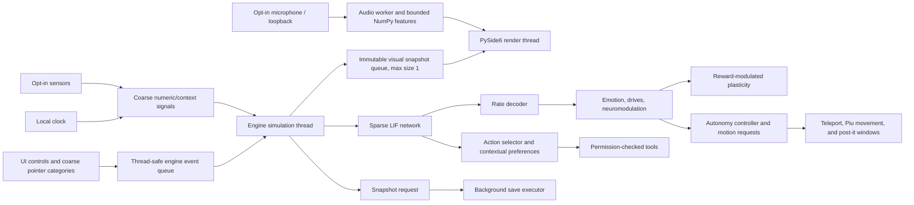

# Architecture

Synapse Pet separates its Qt presentation from its simulation. The main window communicates with the engine through queues; the simulation thread never calls Qt widgets.

## Runtime flow

## Components

| Component | Location | Responsibility |
| --- | --- | --- |
| LIF population and projections | `src/synapse_pet/core/` | Integrate-and-fire state, sparse projections, decoding, homeostasis, and reward-modulated STDP. |
| Emotions and drives | `src/synapse_pet/mind/` | Map numeric activity/reward to simulated affect, needs, and optional sleep consolidation. |
| Engine | `src/synapse_pet/runtime/engine.py` | Own the simulation loop, queues, tool dispatch, snapshots, persistence, and watchdog. |
| Visual state | `src/synapse_pet/runtime/visual_state.py` | Publish immutable state snapshots and interpolate visual changes. |
| Autonomy | `src/synapse_pet/runtime/autonomy.py` | Enforce action budgets and persist post-it template metadata / aggregate habits. |
| Qt interface | `src/synapse_pet/ui/qt_app.py` | Manage floating/panel windows, tray, controls, panel refresh, and telemetry. |
| Renderers | `src/synapse_pet/ui/` | Draw the Piu pixel scene by default, legacy ASCII/HUD and spectral/vector eye views, and CPU fallback. |
| Pixel assets | `src/synapse_pet/assets/pixel/` | Hold sprite atlases, native-depth variants, frame metadata, and JSON pose routes. |
| Motion controller | `src/synapse_pet/ui/pet_motion.py` | Advance scene position, depth, jump height, stride phase, and hysteretic sprite size. |
| Audio service | `src/synapse_pet/sensors/audio_service.py`, `audio_analysis.py` | Optional microphone/system-loopback capture in worker threads; emits bounded numeric features only and keeps no waveform or transcript. |
| Day cycle | `src/synapse_pet/ui/day_cycle.py` | Interpolate local scene palettes and estimate sunrise, sunset, and moon phase without network access. |
| Tools | `src/synapse_pet/tools/` | Validate manifest schemas, enforce permission policy, and run allowed operations. |

## SNN and action selection

The network has sensor, recurrent hidden, and output populations connected by sparse projections. Output firing rates represent named emotional or tool groups. The runtime appends tool-output groups as tools are registered. Context projections, when used, keep separate readout weights over the shared sparse topology; contexts are keyed by hashes in persistence.

The action selector combines a normalized neural score with learned contextual action preferences. The offline evaluation reports the combined policy separately from neural-only and preference-only ablations. No language model or textual encoder is part of this path. `network.tool_output_inhibition` is an experimental output-current adjustment, disabled by default; at the configured 10-step interval it matched the baseline in scenarios b/c and left c/Z below its SNN-only target, so it is not recommended as a release setting.

## Pixel view path

`pet.render_style: pixel` is the default. The UI loads transparent sprite sheets and routes states to frames using `assets/pixel/animations.json`. Movement requests use the common `request_move(target, style)` entry point; scene-mode motion advances x, depth, height, stride, and LOD, while the floating window has its own bounded hop/teleport effects. The floating window mask is generated from the currently selected sprite frame's alpha. Sprite poses are static/source data; the simulation contributes read-only emotional state and spike summaries. The scene interpolates local-time palettes and draws optional local weather effects; sunrise/sunset coordinates are manual YAML values only.

Adding a new emotion-to-frame route can be done in the source animation JSON without an emotion branch in the renderer. A new movement behavior still requires a controller action. See [ART](ART.md) for the asset format and current limits.

## Event and failure boundaries

- UI actions are placed on a thread-safe event queue.
- Visual updates use a bounded queue so a slow frame cannot accumulate stale snapshots.
- Tool work and snapshot disk writes run outside the SNN tick loop.
- Pending tool proposals have a timeout.
- The watchdog surfaces stale ticks, queue sizes, regime, and thread status.
- Runtime exceptions are recorded in a rotating log with traceback; save errors are returned as UI events.
- Audio capture is absent until a user enables a sensor. Its worker emits only short-lived feature values; no waveform or transcript enters engine persistence.

## Storage

All live state is stored in the application data directory. Snapshots preserve the SNN and mind state; SQLite databases hold episodes, action audit records, post-it metadata, notes, and habit aggregates. The repository contains example configs and synthetic evaluation data, not a user's creature database or snapshot.

See [Learning](LEARNING.md), [Autonomy](AUTONOMY.md), and [Privacy](PRIVACY.md) for the boundaries and limitations of those components.
