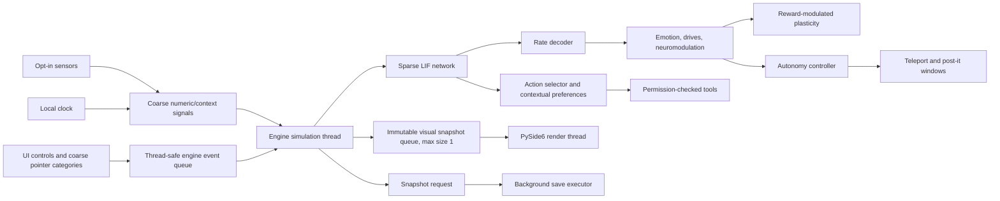

# Architecture

Synapse Pet separates its Qt presentation from its simulation. The main window communicates with the engine through queues; the simulation thread never calls Qt widgets.

## Runtime flow

## Components

| Component | Location | Responsibility |
| --- | --- | --- |
| LIF population and projections | `src/synapse_pet/core/` | Integrate-and-fire state, sparse projections, decoding, homeostasis, and reward-modulated STDP. |
| Emotions and drives | `src/synapse_pet/mind/` | Map numeric activity/reward to simulated affect, needs, and optional sleep consolidation. |
| Engine | `src/synapse_pet/runtime/engine.py` | Own the simulation loop, queues, tool dispatch, snapshots, persistence, and watchdog. |
| Visual state | `src/synapse_pet/runtime/visual_state.py` | Publish immutable state snapshots and interpolate visual changes. |
| Autonomy | `src/synapse_pet/runtime/autonomy.py` | Enforce action budgets and persist post-it template metadata / aggregate habits. |
| Qt interface | `src/synapse_pet/ui/qt_app.py` | Manage floating/panel windows, tray, controls, panel refresh, and telemetry. |
| Renderers | `src/synapse_pet/ui/` | Draw ASCII, HUD, shader-compatible, or CPU fallback views. |
| Tools | `src/synapse_pet/tools/` | Validate manifest schemas, enforce permission policy, and run allowed operations. |

## SNN and action selection

The network has sensor, recurrent hidden, and output populations connected by sparse projections. Output firing rates represent named emotional or tool groups. The runtime appends tool-output groups as tools are registered. Context projections, when used, keep separate readout weights over the shared sparse topology; contexts are keyed by hashes in persistence.

The action selector combines a normalized neural score with learned contextual action preferences. The offline evaluation reports the combined policy separately from neural-only and preference-only ablations. No language model or textual encoder is part of this path.

## Event and failure boundaries

- UI actions are placed on a thread-safe event queue.
- Visual updates use a bounded queue so a slow frame cannot accumulate stale snapshots.
- Tool work and snapshot disk writes run outside the SNN tick loop.
- Pending tool proposals have a timeout.
- The watchdog surfaces stale ticks, queue sizes, regime, and thread status.
- Runtime exceptions are recorded in a rotating log with traceback; save errors are returned as UI events.

## Storage

All live state is stored in the application data directory. Snapshots preserve the SNN and mind state; SQLite databases hold episodes, action audit records, post-it metadata, notes, and habit aggregates. The repository contains example configs and synthetic evaluation data, not a user's creature database or snapshot.

See [Learning](LEARNING.md), [Autonomy](AUTONOMY.md), and [Privacy](PRIVACY.md) for the boundaries and limitations of those components.
