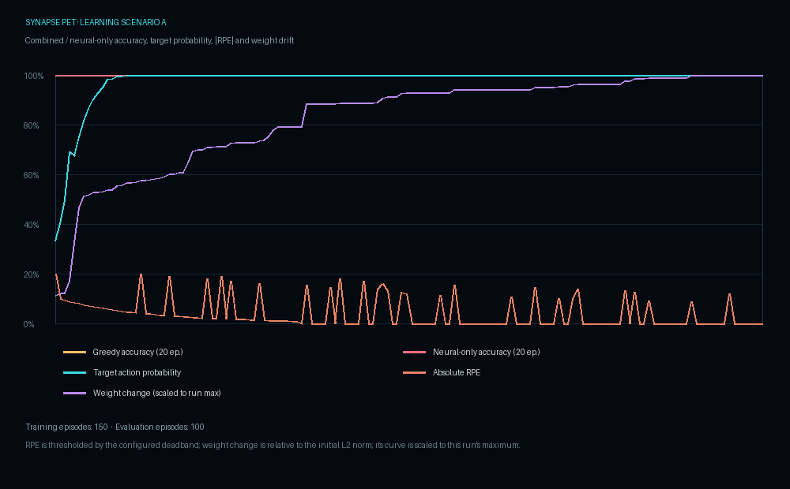
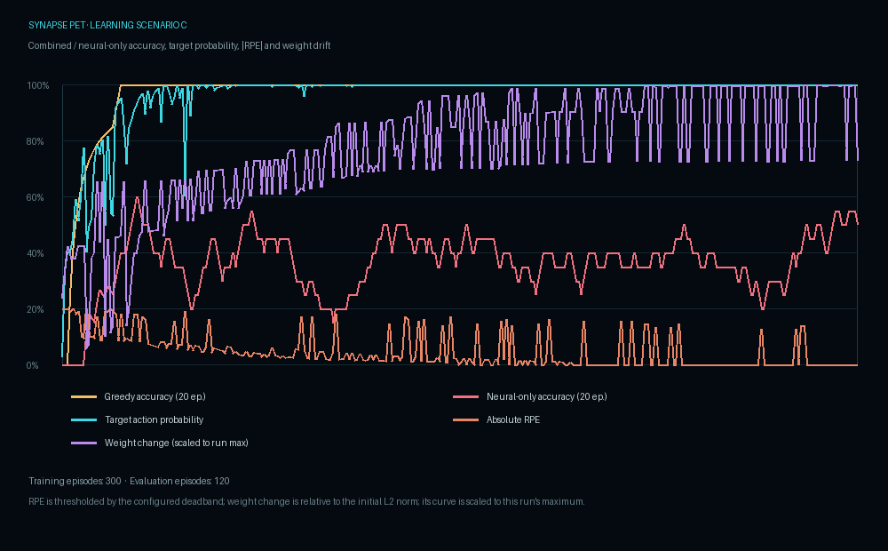
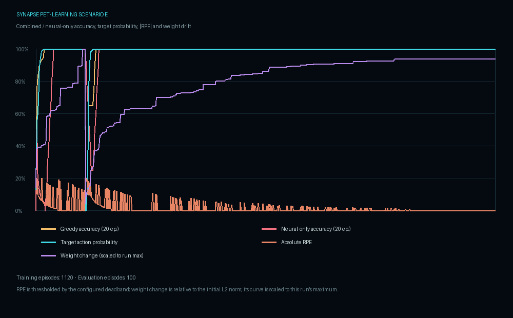

# Learning protocol and recorded results

This page describes the committed offline evaluation artifacts. These are simulator results with artificial contexts/actions; they do not measure usefulness in the live desktop app.

## What changes during learning

- LIF neurons integrate numeric input and emit spikes. A rate decoder exposes named output-group rates.
- R-STDP stores bounded eligibility traces. The learning RPE applies a weight update; affect impulses separately alter simulated mood/comfort.
- Tool-specific credit targets the selected output group when it exists.
- Homeostasis limits population activity.
- The production-like action policy combines neural scores with contextual preferences. `SNN-only` disables the preference term at evaluation time; this is not always the same as training a network without any selector involvement.
- The contextual projection experiment shares sparse topology while allocating each context's output weights on demand. Context creation/reuse and the projection limit are persisted.

## Protocol

The final context-projection run uses seed `20261102`, 600 requested neurons, three artificial actions (`eval_a`–`eval_c`), and categories `X`, `Y`, and `Z`. No real tools are run.

| Scenario | Protocol | Acceptance criterion |
| --- | --- | --- |
| a | 150 training / 100 evaluation episodes in X | >85% |
| b | 120 episodes, reverse mapping, then up to 120 more; 100 evaluation episodes | Readaptation ≤60 episodes and >85% final |
| c | 100 training episodes per interleaved context; 40 evaluation episodes per context | >80% in each of X, Y, and Z |
| d | 500 episodes with 10% inverted feedback; 100 evaluation episodes | >70% |
| e | 120 training episodes in X, 1,000 episodes in Y, then 100 in X | >70% retained |

Training uses 20% exploration; evaluation is greedy and does not update model state. `production_action_available` additionally measures the real selector's initiative threshold, while the primary accuracy is the combined score choice.

## Final recorded table

The table is copied from [`context_projection_stage/summary.md`](learning/context_projection_stage/summary.md). Combined policy means neural rate plus contextual preference. Neural-only is an ablation of the preference term during evaluation.

| Scenario | Combined accuracy | Neural-only accuracy | Neural / preference share of winner score |
| --- | ---: | ---: | ---: |
| a | 100% | 100% | 43% / 57% |
| b | 100%; readaptation 44 episodes | 100% (strict SNN-only training in the rate grid: 100%, 49 episodes) | 21% / 79% |
| c: X | 100% | 100% | 24% / 76% |
| c: Y | 100% | 97.5% | 40% / 60% |
| c: Z | 100% | 77.5% | 32% / 68% |
| d | 100% | 100% | 31% / 69% |
| e | 100% | 67% | 29% / 71% |

Score shares are absolute-term decompositions for the winning combined score. They describe score composition, not causal responsibility. The selector is a substantial contributor, particularly for b, c, and e.

### Curves

Each scenario directory contains its episode-level CSV and PNG. The latest accepted configuration is the context-projection stage.







Other historical runs remain under `docs/learning/` and are not interchangeable with the final stage. The full parameter grid is [`rate_grid.csv`](learning/context_projection_stage/rate_grid.csv).

## Sleep replay and habit observability

Sleep replay is controlled by `sleep.replay_enabled`, false by default. If enabled, the consolidator selects episodes by highest absolute recorded reward, takes at most `sleep.max_replay_episodes`, derives a synthetic sensor feature from the coarse context hash, adds low seeded noise, and performs a small number of replay steps. It does not preserve/replay the original raw input sequence. **No new scenario-e evaluation has been run for this implementation**, so the previous 67% neural-only e result remains the latest measured number.

The `habits` SQLite table stores a fixed coarse context category, action identifier, observation count, mean/last RPE, learned flag, and update time. A one-time `habit_learned` event is emitted after the configured count and positive mean-RPE threshold. The UI notification is informational and does not change SNN topology or action rules.

## Reproduction

From the repository root:

```powershell
.\.venv\Scripts\python.exe -m synapse_pet.sim.learning_eval --output docs\learning\context_projection_stage
```

The evaluation writes CSV, JSON, and PNG outputs. Existing reports were produced with their recorded seeds and settings; small differences in runtime or dependencies may change results. The app itself was not validated by these synthetic runs.
