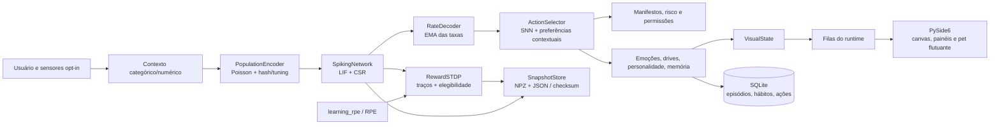

# Arquitetura atual do Synapse Pet

**Auditoria:** 8 de novembro de 2026
**Branch/commit auditados:** `feat/pet-sprite-sheet` / `d46c09f`
**Escopo:** arquitetura observada na Fase 0 e atualizações do núcleo feitas na Fase 2. A otimização não alterou a topologia LIF, suas equações, o formato de snapshot ou dependências.

> O checkout já continha mudanças locais de sprite, renderização e interface antes desta tarefa. Elas foram preservadas. Este documento descreve o checkout auditado, não uma cópia limpa de `main`.

## Visão geral

Synapse Pet é um aplicativo local de companhia para desktop. Seu núcleo é uma SNN vetorizada em NumPy, com projeções esparsas SciPy CSR, neurônios LIF, STDP modulada por recompensa, homeostase e uma camada separada de preferências por contexto. Não é um modelo de linguagem e não gera respostas abertas como um chatbot.

O ponto de entrada `src/synapse_pet/main.py` cria `PetEngine`; no modo gráfico abre `ui/qt_app.py`. A janela comunica-se com a simulação por filas. Sensores são opt-in e vêm desligados na configuração entregue.

## Fluxo de dados



## Núcleo neural

### Seleção de backend numérico

`neural_backend/` define uma interface comum para passo LIF, propagação, STDP, recompensa, crédito de ação e homeostase. A configuração padrão seleciona `numpy`; `cython` e `auto` usam os kernels compilados disponíveis e têm fallback NumPy explícito se a extensão não puder ser carregada. O `PetEngine` aplica a mesma instância do backend ao passo da rede, aprendizado, homeostase e replay de sono; o backend não é persistido no snapshot. Detalhes em [NEURAL_BACKEND.md](NEURAL_BACKEND.md).

### Populações e conectividade

`core/network.py` define `SpikingNetwork`. Para uma rede base com `N` neurônios, aloca 16% para sensores, 64% para neurônios ocultos e o restante para saídas. Saídas de ferramentas podem crescer dinamicamente em grupos. A configuração padrão solicita 600 neurônios; ao registrar as ferramentas locais, a rede medida tem 712 no total. A configuração de benchmark solicita 1.000 e resulta em 1.112 com os grupos dinâmicos. Desde a Fase 2, `step()` reutiliza um buffer `float32` de corrente, redimensionado caso a população cresça; os spikes entregues ao consumidor continuam sendo uma cópia independente.

Há três projeções: sensor→oculta, recorrente oculta→oculta e oculta→saída. Cada projeção é construída com probabilidade de conexão configurável (0,10 por padrão). O sinal de saída dos neurônios ocultos segue a regra de Dale nas projeções recorrente e de leitura; os sinais ocultos são sorteados com 80% excitatórios e 20% inibitórios.

`SparseProjection` guarda `pre`, `post` (`int32`) e pesos (`float32`). Com SciPy disponível, reconstrói uma matriz CSR e usa multiplicação esparsa por vetor; sem SciPy, usa `numpy.bincount` como caminho alternativo. A matriz CSR mantém os pesos como seu vetor de dados.

### LIF

`core/neurons.py` implementa uma população LIF adaptativa vetorizada em `float32`. Em cada passo:

```text
α = exp(-dt / τm)
V ← α · V + I · ganho + ruído_gaussiano
θᵢ ← θ + offsetᵢ
offsetᵢ ← offsetᵢ · exp(-dt / τadapt)
spikeᵢ = (Vᵢ ≥ θᵢ) e não refratário
```

Ao disparar, o potencial volta ao reset, o offset de limiar recebe um incremento adaptativo e o neurônio entra em refratariedade. Células refratárias terminam o passo no reset. O vetor de spikes retornado é uma cópia do estado de spikes da população.

### Aprendizado e seleção

`core/plasticity.py` implementa `RewardSTDP`. A cada passo, os traços pré/pós e a elegibilidade decaem exponencialmente; a elegibilidade combina uma parcela pré→pós (`a_plus`) e uma parcela pós→pré (`a_minus`). `apply_reward` aplica `learning_rate × dopamine × eligibility`, limita os pesos e reaplica Dale. `apply_action_credit` associa atividade recente às arestas que chegam a um grupo de saída recompensado. Desde a Fase 2, `mark()` reutiliza buffers `float32` para converter spikes sem mudar a ordem nem as operações da equação; o crédito de ação usa uma tabela booleana densa para índices válidos e mantém `np.isin` como fallback para índices fora do intervalo ou tipos incomuns.

Os canais estão separados no runtime: `affect_impulse` altera o afeto visual/afetivo; `learning_rpe` é o erro de previsão de recompensa que modula a atualização de STDP. A política também mantém preferências por par contexto/ação. `ActionSelector` normaliza o escore neural pela escala configurada (15 Hz por padrão), soma a preferência contextual e aplica o limiar de iniciativa. Assim, uma decisão pode combinar SNN e seletor; nenhuma dessas partes é um LLM.

**Distinção técnica:** RPE é o sinal de recompensa para `RewardSTDP`, mas não é o único mecanismo no código que altera pesos/topologia. A homeostase escala pesos fora da faixa global de disparo, e o sono pode podar/regenerar arestas e realizar replay. Isso está registrado como dívida em `TECHNICAL_DEBT.md`.

### Homeostase, codificação e decodificação

- `core/homeostasis.py`: calcula atividade média global em janelas de 5 s. Acima de 15 Hz aumenta o limiar global e reduz pesos em 2%; abaixo de 1 Hz reduz o limiar e aumenta pesos em 2%; no intervalo adapta lentamente o limiar em direção a 5 Hz.
- `core/encoding.py`: codifica valores numéricos em curvas gaussianas sobre grupos de neurônios e categorias em duas posições derivadas de BLAKE2b. Converte taxa em probabilidade Poisson por passo e usa um `numpy.random.Generator` com seed.
- `core/decoding.py`: estima a taxa média de cada grupo de saída e a suaviza por EMA, com `alpha = 1 - exp(-dt/tau)`.
- `core/neuromodulators.py`: mantém dopamina, estresse, humor e energia. O RPE atualiza uma expectativa por contexto; o humor tem componentes de relaxamento rápida/lenta e limites suaves.

## Cognição (`mind/`)

| Módulo | Responsabilidade observada |
|---|---|
| `action_selection.py` | candidatos, limiar neural, iniciativa e preferências contexto/ação |
| `drives.py` | drives sociais, estimulação, repouso e tempo desde contato |
| `emotions.py` | felicidade, energia, medo, curiosidade, tédio, afeto e confiança |
| `episodic_memory.py` | journal SQLite de episódios e agregados de hábitos; consultas para replay |
| `personality.py` | traços numéricos seeded e ajustes pequenos por recompensa/recusa |
| `sleep.py` | detecção de sono por inatividade, replay limitado opcional, poda e regrowth de arestas |

## Runtime, ferramentas e persistência

`runtime/engine.py` é o coordenador do runtime: cria/recarrega rede e mente, agrega contexto, executa ticks, atualiza aprendizado/cognição, expõe `VisualState`, despacha ferramentas, atende filas, salva e vigia a thread. O tick ativo usa `tick_active_ms=50` (25 subpassos de 2 ms); o tick de repouso usa uma única atualização de 250 ms. Durante sono, o loop tem espera adicional.

O engine possui uma thread de simulação, watchdog e filas distintas para eventos, propostas, resultados e estado visual (`visual_updates` tem capacidade 1). Escritas de snapshot são submetidas a executor; captura consistente dos arrays ocorre no caminho do engine e compressão/escrita em disco é feita em background.

Ferramentas descrevem parâmetros em `tools/manifest.py`, validam nome, tipo, obrigatoriedade, limites e comprimento antes de executar. Risco médio exige aceite, risco alto exige ação explícita, e risco baixo é limitado por quota. `Sandbox` aplica allowlist a pastas, comandos e aplicativos. Plugins Python instalados são carregados como código local confiável.

`runtime/persistence.py` grava snapshot versionado (versão 2 no checkout) em NPZ mais manifesto JSON com SHA-256, substituição atômica e retenção de backups. Inclui topologia/pesos, estado LIF, estado RNG, contexto e projeções de saída por contexto. Migração de crescimento é opt-in e a configuração distribuída deixa `allow_neuron_growth_migration: false`. Memória episódica, hábitos, ações e post-its usam bancos SQLite locais separados.

O snapshot não inclui os acumuladores de traço/elegibilidade dos objetos `RewardSTDP`, estado interno do decodificador nem acumuladores da janela de homeostase. Portanto, carregar restaura rede/pesos/mente persistidos, mas não é um checkpoint exato de cada variável transitória do runtime.

## Sensores e privacidade

`SensorManager` inicia apenas sensores habilitados. Na configuração auditada, entrada, aplicativo em foco, arquivos, clipboard, estatísticas, geometria, microfone, loopback e plataformas visuais estão desligados. O sensor de janela lê o nome do executável e emite apenas a categoria configurada; não lê título. O sensor de clipboard, quando ativado, retorna comprimento e mantém um digest efêmero, não o conteúdo. O registro de ações exclui texto digitado e títulos. Áudio e geometria são serviços opcionais separados.

## Interface

`main.py` usa a aplicação PySide6 (`ui/qt_app.py`); `ui/app.py` e `ui/avatar.py` ainda contêm a interface Tkinter anterior. A janela Qt coordena painel, bandeja, pet flutuante, sensores, debug, aprendizagem, post-its e animação de movimento. `EyeCanvas` seleciona renderizadores; há caminhos ASCII/CPU, OpenGL, olhos vetoriais/espectrais e pixel art/sprite. O estado visual chega da fila do engine e a GUI o consulta por timer; o trabalho da SNN fica na thread do engine.

Os módulos de UI estão listados em `docs/architecture/REPOSITORY_INVENTORY.json` e agrupados por responsabilidade no código: `qt_app`, canvas/renderizadores, movimento e superfícies do desktop, `sprite_adapter`, `teleport`, janelas de post-it/debug e interface Tk legada. A GUI e a renderização não são exercitadas por esta auditoria em um desktop interativo: os testes são headless.

## Dependências e qualidade

Dependências obrigatórias declaradas no `pyproject.toml`: NumPy, SciPy, PyYAML, psutil, PySide6 Essentials, ModernGL e Pillow. Extras opcionais: `pynput`/`watchdog` para Windows, `SoundCard`/`pycaw` para áudio, `pytest`/`tqdm` para desenvolvimento e Cython no extra `native`. Os kernels Cython opcionais cobrem STDP, LIF e propagação CSR; a configuração padrão continua NumPy. Os resultados CSR estão em [PHASE6_CSR_REPORT.md](../performance/PHASE6_CSR_REPORT.md).

A CI GitHub Actions roda `pytest` no Windows e Ubuntu, com Python 3.12 e Qt offscreen. Na validação local pós-Fase 3 com Python 3.14.10 e Qt offscreen, foram coletados 158 testes: 157 passaram e um teste de geometria do salto falhou. A falha e seus limites estão descritos em `TECHNICAL_DEBT.md` e `benchmarks/results/validation_phase03.json`.

## Árvore de componentes (resumo)

```text
src/synapse_pet/
├── core/       SNN, LIF, CSR, STDP, codificação, decodificação, neuromodulação
├── mind/       emoções, drives, personalidade, memória, sono, seleção de ações
├── runtime/    engine, scheduler, autonomia, configuração, persistência e estado visual
├── sensors/    sensores locais opt-in e análise/serviço de áudio
├── sim/        determinismo e avaliação de aprendizado
├── tools/      schema, permissões, sandbox, registro e ferramentas locais
└── ui/         PySide6/Tk, renderizadores, pet desktop, movimento e painéis
```

O inventário integral (pastas, contagem por extensão e caminhos relativos) está em [REPOSITORY_INVENTORY.json](REPOSITORY_INVENTORY.json). A contagem ignora `.git`, `.venv`, caches, diretórios de build e `work/`, que é staging local ignorado pelo Git para dependências/probes.
