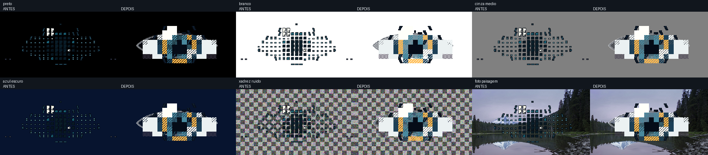

# Etapa 1 — Legibilidade do olho ASCII

## Comparação visual

Capturas antes/depois em preto, branco, cinza médio, azul escuro, padrão xadrez com ruído e foto:

As imagens individuais estão nas pastas `before/` e `after/`. A foto é uma imagem CC0 de Bonnie Moreland, guardada em `assets/`; a fonte e a licença estão em `assets/PHOTO_SOURCE.txt`.

## Contraste

O contorno usa duas cores. A coluna de contorno mostra o percentil 5 do melhor contraste local entre a linha escura e a clara, medido contra a luminância dos pixels do fundo na região do olho. Antes havia apenas a linha escura. A pupila é comparada à cor-base da íris, pois fica dentro dela e não diretamente sobre a área de trabalho.

| Fundo | Contorno antes | Contorno depois | Pupila / íris depois |
|---|---:|---:|---:|
| Preto | 1,07:1 | 20,43:1 | 4,99:1 |
| Branco | 19,64:1 | 19,46:1 | 4,99:1 |
| Cinza médio | 4,97:1 | 4,93:1 | 4,99:1 |
| Azul escuro | 1,08:1 | 17,77:1 | 4,99:1 |
| Xadrez + ruído | 1,59:1 | 4,59:1 | 4,99:1 |
| Foto | 1,12:1 | 7,70:1 | 4,99:1 |

O contorno e a pupila superam 3:1 nos seis fundos com a métrica descrita acima.

## Desempenho

Render headless com pintura Qt para uma imagem 320×180, durante 8 segundos por regime. CPU é a soma do tempo de renderização das amostras dividida pelo tempo de execução.

| Regime | Antes | Depois | Variação |
|---|---:|---:|---:|
| Ativo, 30 FPS | 8,22% · 2,741 ms/quadro | 7,53% · 2,511 ms/quadro | −8,4% |
| Repouso, 5 FPS | 1,42% · 2,842 ms/quadro | 1,36% · 2,727 ms/quadro | −4,0% |

Ambos ficaram dentro da meta de até 10% da linha de base. O teste executou 240 quadros ativos e 40 em repouso por amostra, mantendo as taxas-alvo.

## Escopo e limites desta etapa

- O tema automático consulta apenas a preferência claro/escuro do Windows no Registro. Nenhum pixel da tela é capturado ou amostrado.
- A comparação e o benchmark usaram renderização Qt headless e fundos locais/sintéticos. A interação visual na área de trabalho real ainda não foi validada.
- A suíte pytest, presets de densidade, documentação principal e refinamentos foram deixados para a Etapa 2, após aprovação.
